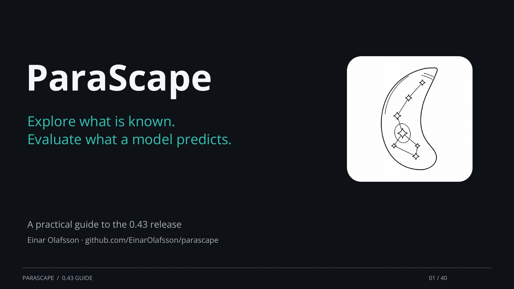

# ParaScape

[](https://einarolafsson.github.io/parascape/deck/)

[← Back](https://github.com/EinarOlafsson/parascape/blob/main/docs/deck/pages/40.md) ·
[Next →](https://github.com/EinarOlafsson/parascape/blob/main/docs/deck/pages/02.md) ·
[Open slide viewer](https://einarolafsson.github.io/parascape/deck/) ·
[PDF](https://github.com/EinarOlafsson/parascape/blob/main/docs/deck/parascape_deck.pdf) ·
[PowerPoint](https://raw.githubusercontent.com/EinarOlafsson/parascape/main/docs/deck/parascape_deck.pptx) ·
[Home page](https://einarolafsson.github.io/projects/parascape/)

[](https://einarolafsson.github.io/projects/parascape/)
[](#install)
[](#install)
[](https://einarolafsson.github.io/parascape/guide.html)
[](https://github.com/EinarOlafsson/parascape/actions/workflows/checks.yml?query=branch%3Amain)
[](https://github.com/EinarOlafsson/parascape/issues)
[](https://pypi.org/project/parascape/)
[](https://pepy.tech/projects/parascape)
[](https://einarolafsson.github.io/parascape/API.html)
[](https://einarolafsson.github.io/parascape/guide.html)
[](https://github.com/EinarOlafsson/parascape/blob/main/CITATION.cff)
[](https://github.com/EinarOlafsson/parascape/blob/main/LICENSE)
[](https://github.com/EinarOlafsson/spacr)
[![ParaScape PyPI download ranking over the previous 30 complete days](https://img.shields.io/badge/dynamic/json?url=https%3A%2F%2Fsql-clickhouse.clickhouse.com%2F%3Fuser%3Ddemo%26param_package_name%3Dparascape%26param_days%3D30%26query%3DWITH%2B%2528%2BSELECT%2Bsum%2528count%2529%2BFROM%2Bpypi.pypi_downloads_per_day%2BWHERE%2Bproject%2B%253D%2B%257Bpackage_name%253AString%257D%2BAND%2Bdate%2B%253E%253D%2BtoDate%2528now%2528%2527UTC%2527%2529%2529%2B-%2B%257Bdays%253AUInt16%257D%2BAND%2Bdate%2B%253C%2BtoDate%2528now%2528%2527UTC%2527%2529%2529%2B%2529%2BAS%2Bdownloads%2BSELECT%2Bdownloads%2BAS%2Bpackage_downloads%252C%2BcountIf%2528n%2B%253E%253D%2Bdownloads%2529%2BAS%2Brank%252C%2Bcount%2528%2529%2BAS%2Btotal_packages%252C%2B100.0%2B%252A%2Brank%2B%252F%2BnullIf%2528total_packages%252C%2B0%2529%2BAS%2Bpercentile%252C%2Bif%2528%2Btotal_packages%2B%253D%2B0%2BOR%2Bdownloads%2B%253D%2B0%252C%2B%2527no%2Bdata%2527%252C%2Bconcat%2528%2B%2527top%2B%2527%252C%2BtoString%2528ceil%25281000.0%2B%252A%2Brank%2B%252F%2BnullIf%2528total_packages%252C%2B0%2529%2529%2B%252F%2B10%2529%252C%2B%2527%2525%2527%2B%2529%2B%2529%2BAS%2Bmessage%2BFROM%2B%2528%2BSELECT%2Bproject%252C%2Bsum%2528count%2529%2BAS%2Bn%2BFROM%2Bpypi.pypi_downloads_per_day%2BWHERE%2Bdate%2B%253E%253D%2BtoDate%2528now%2528%2527UTC%2527%2529%2529%2B-%2B%257Bdays%253AUInt16%257D%2BAND%2Bdate%2B%253C%2BtoDate%2528now%2528%2527UTC%2527%2529%2529%2BGROUP%2BBY%2Bproject%2B%2529%2BFORMAT%2BJSON&query=%24.data%5B0%5D.message&label=Rank&logo=pypi&logoColor=white&color=brightgreen&cacheSeconds=86400)](https://clickpy.clickhouse.com/dashboard/parascape)

ParaScape brings the published evidence about one parasite gene into a single place and
predicts what has not been measured, with a stated uncertainty on every prediction. It holds
expression, fitness screens, localisation, protein features, interactions and literature
annotation for 8,140 *Toxoplasma gondii* and 5,720 *Plasmodium falciparum* genes, viewed one
organism at a time. Starting from a gene, a gene list or your own screen table, it produces
source-linked evidence for each gene, embeddings and clusterings you choose the inputs for,
held-out predictions with calibrated confidence, and ranked candidate lists for follow-up.
Every prediction is graded against known answers it was not allowed to see, and a prediction
that does not clear the bar ranks genes rather than writing anything down. Runs as a desktop
application, or headlessly for the command-line pipelines.

[User guide](https://github.com/EinarOlafsson/parascape/blob/main/docs/guide.md) ·
[Python API](https://github.com/EinarOlafsson/parascape/blob/main/docs/API.md) ·
[Dataset catalogue](https://github.com/EinarOlafsson/parascape/blob/main/docs/datasets.md) ·
[Changes](https://github.com/EinarOlafsson/parascape/blob/main/CHANGELOG.md)

## Try ParaScape

```bash
conda create -n parascape python=3.12 -y
conda activate parascape
python -m pip install parascape
parascape
```

On first launch a prompt offers the versioned data download from [Hugging Face](https://huggingface.co/datasets/einarolafsson/parascape-data). After it verifies, browsing works offline; the datasets live outside the package. Protein structures are fetched
when requested and cached.

## Where to start in the app

The home screen asks what you have, and there are three answers, because the data is a table of
genes and there are only three ways to point at it.

| | You have | It opens on |
|---|---|---|
| **Gene** | one gene — a row | its card: structure, every dataset it appears in, its partners, what is predicted for it and how well that prediction grades |
| **List** | a set of genes — a block of rows | what the set has in common, which mechanism it points to, and a ranking of the genome by resemblance to it |
| **Label** | a question — a column | the strategies that can answer it, the data each is allowed to use, and the scorecard saying whether the answer may be trusted |

A card whose view does not exist yet, or whose data is absent, is shown greyed **with the reason**
rather than hidden — twelve of the thirty-three are, today, including the set-level mechanism and
ranking views above. `Label ▸ Fill` is greyed by computation, not by hand: it opens only when a
question has cleared its bar, and none has. The search bar reaches all of it — genes, questions,
strategies, datasets and guide pages ranked together, so the best answer wins whatever kind of
thing it is.

## Install

Python 3.12 or newer. The desktop app needs a display and OpenGL.

From a checkout:

```bash
git clone https://github.com/EinarOlafsson/parascape.git
cd parascape
pip install -e .
parascape
```

For an NVIDIA GPU on Linux x86_64 with a CUDA 12 driver, `pip install "parascape[gpu]"`;
`parascape-install-gpu` inspects the driver and offers a command. macOS and Windows run analyses
on the CPU, and the 3D display still uses OpenGL. Optional extras install separately:
`parascape[sequence]`, `parascape[structures]`, `parascape[ingest]`.

## Strategies

The **strategies** tab lists 39 named ways of turning the combined data into a claim — from
holding a category out and searching for the map that finds it, to calling genes with a stated
error rate (conformal prediction), to learning how far to trust each kind of evidence (stacking).
Each carries a self-test that hides known information, asks for it back, and compares the answer
against the same procedure on shuffled data; each reports a **scorecard** of the standard metrics
for its kind of task, in a fixed order, so strategies doing the same thing compare number by
number. The **start here** tab asks what you have instead, one question at a time, and ends at
the three to six strategies worth running, ranked by their grade on that organism with their
settings filled in.

Every column is annotated with the **kind of knowledge** it carries, so predicting a label
excludes all evidence of that same kind. Without it an embedding built from "all the data" and
scored against held-out localisation is circular, and the circularity is in the input selection
rather than the model, where nobody sees it.

<!-- calibration:start -->

Latest publication 2026-11-08 (7,640 self-tests in this sweep). Tables retain earlier results for unswept strategies and species, with each entry's sweep recorded in the calibration file. Each strategy's self-test runs over a grid of its settings, several held-out known labels and five seeds. **Skill** puts every metric on one scale -- 0 is the same procedure on shuffled data, 1 is perfect. *Tuned* is the best setting chosen on seeds 1-3 and reported on seeds 4-5, so it is not the luckiest of many settings. Intervals are 95%, by bootstrap over held-out targets and runs. [Every number, per target and per setting](docs/calibration.md).

**Plasmodium falciparum** -- 26 reliable, 9 weak, 2 untestable, 2 works when tuned

**Toxoplasma gondii** -- 30 reliable, 6 weak, 2 works when tuned, 1 untestable

<!-- calibration:end -->

<!-- scorecards:start -->

### Scorecards: the same metrics for every strategy doing the same task

Skill says how far above chance a strategy is; the scorecard says in what way. Each strategy performs one of six tasks, and every strategy performing a task reports that task's metrics, in this order, on the same hidden genes as its verdict: mean [95% CI] over held-out labels and seeds, at the default settings, on *T. gondii*. [Every metric explained, the techniques behind each strategy, *P. falciparum* and the tuned settings](docs/scorecards.md).

<!-- scorecards:end -->

[All 39 strategies](https://github.com/EinarOlafsson/parascape/blob/main/docs/strategies.md) ·
[their measured verdicts](https://github.com/EinarOlafsson/parascape/blob/main/docs/calibration.md) ·
[every scorecard metric](https://github.com/EinarOlafsson/parascape/blob/main/docs/scorecards.md) ·
[explore, predict and compare](https://github.com/EinarOlafsson/parascape/blob/main/docs/workflows.md)

## Explore a screen

1. Choose the organism under **File → Species**.
2. Search for a gene, or drop a CSV, TSV, XLS or XLSX gene list onto the window.
3. Colour and filter the map by the measurements you want to compare.
4. Click a gene to read its evidence and inspect each kind of relationship separately.
5. Select a group with a lasso or brush and export the list for follow-up.

[](https://raw.githubusercontent.com/EinarOlafsson/parascape/main/docs/screenshots/map_rotation.png)

**compare → Gene expression** covers all 296 verified RNA-seq runs from 23 studies, with samples
browsable and values exportable; coverage is partial
([RNA expression](https://github.com/EinarOlafsson/parascape/blob/main/docs/rna-expression.md)).
**compare → Coexpression** finds RNA or protein features that vary together within one source
([coexpression](https://github.com/EinarOlafsson/parascape/blob/main/docs/coexpression.md)). The package
ships frozen sequence representations for 8,064 *T. gondii* proteins and AF3 summary features for 1,210
exactly mapped genes, both optional prediction inputs
([protein sequences](https://github.com/EinarOlafsson/parascape/blob/main/docs/protein-sequences.md),
[local AF3 structures](https://github.com/EinarOlafsson/parascape/blob/main/docs/structures.md)).

Each point is a gene, positioned by an embedding of the features you selected. Nearby points have
similar inputs — that is all. Proximity does not demonstrate shared function or physical
interaction, and missing evidence is shown separately from measured values rather than as a zero.

In the [0.43 benchmark](https://github.com/EinarOlafsson/parascape/blob/main/docs/benchmark-0.43.md),
boosted trees with sequence and structure features reached 56.2% localisation accuracy across
held-out orthogroups; UMAP neighbours did less well and several rare classes stayed poorly
recovered. These are hypotheses, not established annotations.

## Working with spaCR

[spaCR](https://github.com/EinarOlafsson/spacr) analyses microscopy screens. Its launcher installs
and opens ParaScape in a separate Python environment. Export a gene-level table from spaCR and
import it into ParaScape; launching the app does not transfer results.

## Data and reproducibility

**[Full table of included data and source links →](https://github.com/EinarOlafsson/parascape/blob/main/docs/datasets.md)**

**Tools → Datasets** opens sources, coverage, provenance and stored values ([guide](docs/dataset_browser.md)).

The catalogue lists all 130 registered datasets and computed layers, with their
measurements, coverage, publication references, and links to source data or inputs.
Coverage differs by organism and assay;
absence from a literature search does not establish that a gene has never been studied.

```bash
python -m parascape.paths       # show data locations and missing cache files
python -m parascape.build_graph # rebuild from available source datasets
```

| Variable | Purpose |
|---|---|
| `PARASCAPE_CACHE` | Override the directory containing built gene tables and graphs |
| `PARASCAPE_DATA` | Locate raw datasets used for rebuilding |
| `PARASCAPE_STATE` | Override the directory for saved runs, annotations, and downloads |

Methods are described in [MATERIALS_AND_METHODS.md](https://github.com/EinarOlafsson/parascape/blob/main/MATERIALS_AND_METHODS.md).
[HANDOFF.md](https://github.com/EinarOlafsson/parascape/blob/main/HANDOFF.md) contains the development history and earlier design decisions.
The [repository review](https://github.com/EinarOlafsson/parascape/blob/main/docs/repository-review.md) describes the current architecture
and its limitations.

## Development

```bash
pip install -e ".[dev,docs]"
QT_QPA_PLATFORM=offscreen pytest tests/test_app_smoke.py tests/test_docstrings.py -q
python scripts/build_docs.py
```

Open `docs/site/index.html` for the guide and generated API reference.
Some tests need source datasets, CUDA, or a working OpenGL context; see
[development and releases](https://github.com/EinarOlafsson/parascape/blob/main/docs/releases.md) for the release checks.

Develop on `nightly` and merge checked changes into `main`. To release, update all
package and runtime versions together with `python scripts/release.py bump 0.43.0` and update
the changelog before merging. A version increase on `main` triggers checks,
builds, PyPI publishing, and a GitHub release. Ordinary merges do not publish.
The initial PyPI account setup is described in the release guide.

The source code is distributed under the [MIT license](https://github.com/EinarOlafsson/parascape/blob/main/LICENSE).
Source datasets and third-party artwork retain their own licenses and attribution.
