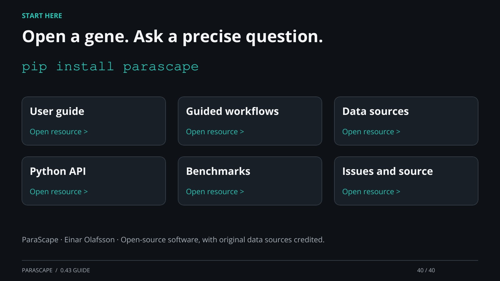

[← Back](39.md) · 40 / 40 · [Next →](01.md) · [Home page](https://einarolafsson.github.io/projects/parascape/)

## Open a gene. Ask a precise question.

pip install parascape

User guide: https://einarolafsson.github.io/parascape/guide.html

Guided workflows: https://einarolafsson.github.io/parascape/workflows.html

Data sources: https://einarolafsson.github.io/parascape/datasets.html

Python API: https://einarolafsson.github.io/parascape/API.html

Benchmarks: https://einarolafsson.github.io/parascape/benchmark-0.43.html

Issues and source: https://github.com/EinarOlafsson/parascape

ParaScape · Einar Olafsson · Open-source software, with original data sources credited.

[Supporting documentation](https://einarolafsson.github.io/projects/parascape/)
